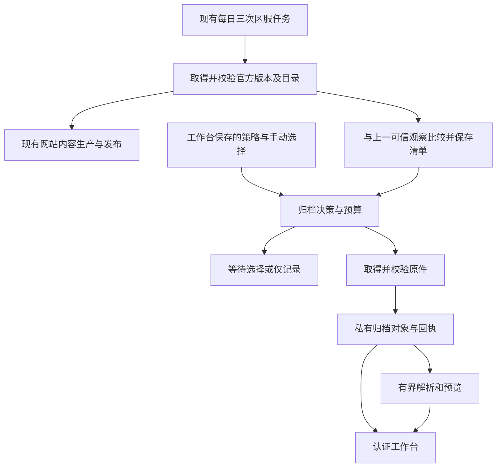

# 官方更新档案设计

状态：用户已确认总体方向，本文为具体设计稿；未实现、未修改生产配置、未做云端验收。

日期：2026-10-20。源码核对基线：`2e6f3a2`。

## 1. 已确认的方向

- 复用现有北京时间 **09:00、14:00、19:00** 的每日三次检查；每次检查已启用的 Global、JP 区服。不增加轮询、监控服务或新的自动触发时间。
- 检测官方客户端、资源目录和 Master 数据的变化，保存新增、修改内容，供管理员在工作台查看和下载解包。
- 活动周期用于分组，不决定检测边界，不按十天重置基线，不以活动开放时间过滤资源。
- 大版本或超过容量预算时保留变更清单，转为管理员手动选择保存。
- 原始文件归档与预览生成分开；未知文件和解析失败文件仍可保存原件。
- 本次只整理设计，不进入实施、发布或生产数据操作。

## 2. 目标、范围与限制

### 2.1 使用场景

一个活动期间，官方先发布新客户端，再发布数次热资源。网站正常更新已支持的卡牌、歌曲、剧情等资料；更新档案另外保存官方本次新增或替换的文件，包括暂时没有页面、没有 Master 关联、尚未开放和无法识别的内容。

管理员可以回答：

1. 今天三次检查分别看到了什么版本？哪些检查失败或没有执行？
2. 这次增加、修改、移除了哪些文件？哪些原件已保存，哪些等待选择？
3. 哪些内容能直接预览？哪些需要下载到本机继续解包？
4. 某张图片或某份配置是在哪一批首次发现、后来又在哪一批修改的？

### 2.2 首版范围

包括：双服独立归档；资源目录、Master 和客户端包内文件的变更记录；原件保存；活动分组；容量保护；手动选择；图片、文本和支持格式音频的预览；原件及选中文件导出；解析状态与失败诊断。

不包括：更高频检查、历史版本全量补档、任意官方隐藏地址发现、完整客户端还原、通用反编译、执行热更新代码、任意模型在线运行、自动判断所有未公布活动、把归档内容自动发布到公开网站。

### 2.3 可观察范围

- 只承诺记录实际检查时能取得的官方版本。两次检查之间被替换且撤回的版本可能漏掉。
- 发现时间表示本站首次观察时间；没有明确上游时间时，不推测官方上传时间。
- 官方目录没有列出、客户端包中也不存在的文件不在发现范围。
- 沿用现有官方版本信号决定何时重新取得目录；上游不改版本信号却原地替换文件时，不承诺在该次轻量检查发现。实际重新取得材料时，摘要冲突须明确报错，不能覆盖旧证据。
- 只比较文件声明和字节内容，不承诺识别“下个版本”“下期活动”的业务含义。有关联证据时展示关联；否则显示未关联。
- 调度时点沿用现有策略。记录计划检查时点与实际开始时间；不把 GitHub 调度时间当成保证执行或发布的期限。

## 3. 当前源码基础与需要新增的边界

本节是本地源码结论，不代表重新核验了线上部署。

| 现有入口 | 可复用能力 | 设计中的补充 |
| --- | --- | --- |
| [content-r2.yml](../../.github/workflows/content-r2.yml)、[r2_schedule.py](../../tools/r2_schedule.py) | 双服每日三次检查、同服串行、不取消运行中的任务 | 在同次执行内增加独立的归档结果与待办处理 |
| [global_remote_sync.py](../../tools/global_remote_sync.py) | 完整目录记录、变更计划、Master 比较、原始下载与预算 | 将混合的新增/修改状态细分，持久化归档批次和待保存文件 |
| [jp_remote_sync.py](../../tools/jp_remote_sync.py) | 版本绑定的目录/Master 快照、资源身份、校验后下载 | 补充 JP 的归档比较和全类型变更保存，不能直接套用 Global 的地址规则 |
| [current_resources.py](../../tools/current_resources.py) | 按需下载、缓存校验、Unity 解码和部分对象提取 | 从网站所需对象扩展为归档任务，但保留网站生产接口的职责 |
| [r2_production_gate.py](../../tools/r2_production_gate.py) | 网站生产的可信无变化判断和轻量恢复 | 归档另有进度；网站无变化不等于归档待办完成 |
| [r2_state.py](../../tools/r2_state.py) | 私有不可变对象和条件指针写入的实现基础 | 归档独立命名空间和索引，不把历史档案放入日常完整恢复集合 |
| [backend/admin/app.py](../../backend/admin/app.py)、[admin.mjs](../../backend/admin/static/admin.mjs) | 私有认证工作台、只读预览模式、生产状态展示 | 新增更新档案入口、受认证的文件读取与归档操作 |
| [resource_classification.py](../../tools/resource_classification.py) | 基于证据分类，未知关系保留待确认 | 分类用于检索和预览，不能用公开发布允许清单过滤归档原件 |

知识图谱覆盖核对显示 `tools/`、`docs/` 和管理静态资源目录被当前索引排除；上述相关结论使用定向源码读取补足。没有以图谱未命中推断功能不存在。

## 4. 总体方案

选择“记录每次观察 + 保存增量原件 + 派生预览”。只留清单无法抵抗上游撤回；每次保存全量快照会放大存储和恢复成本。



网站生产和归档共享经校验的来源身份，但分别维护状态。归档失败不能取消正常网站更新；网站构建、公开上传或晋级失败也不能丢掉已观察的归档清单和已保存原件。凭据、可信客户端和官方探测本身失败时，如实记录失败，不伪造可用快照。

## 5. 数据模型与身份

### 5.1 三类核心记录

| 记录 | 主要字段 | 用途 |
| --- | --- | --- |
| `CheckAttempt` 检查记录 | 区服、计划时点、实际起止时间、运行 ID、探测结果、来源快照引用、分阶段结果 | 每次运行都记录；无变化或失败也可观察 |
| `SourceSnapshot` 来源快照 | 区服、客户端版本/身份、资源版本、catalog 摘要、Master 清单摘要、客户端文件清单引用、可信材料引用 | 固定一次实际观察到的来源证据 |
| `ArchiveBatch` 更新批次 | 来源快照、比较基线、变更清单、文件归档状态、决策原因、保存尝试与预览引用 | 同一来源重跑不重复建批次；一个批次可多次补存 |

活动分组 `ActivityGroup` 独立保存名称、区服、可选活动 ID、展示起止时间、批次成员与修订号。改分组不会改变来源身份、文件状态或检测基线。

### 5.2 文件记录

每项保存：

- 来源类别：`remote_asset`、`master` 或 `client_entry`。
- 官方地址键或包内相对路径、原始名称、provider/资源类型、声明大小与上游 hash 及其算法。
- 变更类型：`added`、`modified`、`removed`、`metadata_changed`；保存前后引用。
- 下载后的实际字节数、本站 SHA-256、校验方法、不可变对象引用。
- 网站收录证据（收录/未找到对应映射/暂未核对）、可选实体关联及证据。
- 归档状态、失败原因、来源可获取性、解析状态和解析器版本。

目录 hash、HTTP ETag 和本站 SHA-256 是不同字段，不能互相冒充。没有可验证内容摘要的上游记录，必须保留其可信目录绑定、实际下载证据及本地 SHA-256，界面不能宣称具有上游未提供的摘要认证。

### 5.3 身份与幂等

- 来源身份由规范化的区服、官方版本/包观察身份及实际取得的 catalog/Master 清单摘要产生，不包含检查时间、源码提交或活动分组。
- 尚未取得可信目录、只收到“客户端需要升级”信号时，先记录在 `CheckAttempt` 中，显示“发现客户端更新，目录未取得”；不建立可比较的完整来源快照，不推进基线。
- 客户端详细清单可以晚到，作为来源快照的不可变补充证据。清单修订单独编号，不覆盖已接受证据。
- 同一来源和比较基线对应同一批次；重跑增加尝试记录。文件以 SHA-256 去重，引用不依赖临时 runner 路径。
- 仅修改归档解析器时，可重建预览；不能制造一批“官方更新”。

## 6. 如何比较更新

### 6.1 热资源

比较完整可信 catalog 中的资源，不按网站当前支持的资源类型筛选。使用区服适配器提供的稳定资源键；不能确认稳定对应关系时保守记为旧项移除、新项增加。

- 新键：新增。
- 同一稳定键的内容 hash/大小变化：修改。
- 仅地址目录、provider 等元数据变化，内容 hash 和大小不变：元数据变化；仍需验证可复用身份。
- 旧键消失：移除。保留旧归档，不下载不存在的新文件。
- 所谓“改名”只有明确关系证据才展示，否则不猜测。

先保存官方容器级差异；解析后再生成容器内图片、文本、音频等对象清单。不能把一个 bundle 被替换等同于其全部内部图片都改变；未完成对象比较时明确显示“容器变更，内部差异未解析”。

### 6.2 Master 数据

比较完整 Master 清单，保存新增或改变的原始文件。解密支持时另存结构化预览。JSON 差异忽略对象键顺序，不擅自重排数组或猜测业务主键；只有明确契约的表才提供按记录 ID 的增删改摘要。

### 6.3 客户端包

沿用现有包名、版本、签名及分包身份验证。验签通过后，对 APK/分包内普通文件生成路径、解压后大小和 SHA-256 清单，比较新增、修改和移除；ZIP 时间戳、压缩方式变化不单独视为资源内容变化。

首版归档单位是包内文件。默认保存选中的变化文件，而不是自动永久保存每个完整 APK/XAPK。完整安装包为单独可选项，按完整大小预算；其字节若已被网站生产取得，可以验证后复用。包内变化文件集合不能宣称可重建完整可安装客户端。

包很大且尚未下载时，先显示官方包身份、已知大小和“内部清单未取得”。大版本不为归档单独自动下载大包来换取清单；管理员可选择“获取包并分析”，网站生产已经可信取得的包则可直接分析。因整包下载才能提取一个文件，工作台必须同时显示预计归档大小和实际需要取得的容器大小。

读取压缩包须限制条目数、总展开大小、单条目大小、压缩比例和工作时间，拒绝路径逃逸、重复冲突路径和链接条目。异常包不影响现有可信客户端基线。

### 6.4 初次启用

首次运行从当前可信目录建立基线，显示“归档从本次开始”。不把全目录算作新增，不自动补下全部历史文件。

客户端文件基线优先使用现有已验证包；材料缺失时客户端比较单独显示“未建立基线”，等待明确选择取得当前包，不影响热资源与 Master 归档。后续客户端基线缺失的更新属于未知规模，转手动处理。

## 7. 发现进度与保存进度

必须分开维护：

1. **最后可信观察**：目录、差异清单和批次已在私有存储提交后，才可推进。它用于下一次比较。
2. **文件保存进度**：按批次、按文件维护，不能用“上次成功归档版本”这一单值替代。

例：A 为已建基线；14:00 发现 B，因超限等待选择；19:00 发现 C。

- C 与 B 比较，避免重复将 B 的大量内容列为新增。
- B 的待选文件继续存在，不能因 C 出现或网站已更新而消失。
- 处理 B 时固定使用 B 的来源身份；旧地址失效则标记不可取得，不能拿 C 的同名文件冒充 B。
- 已有可信同内容对象可复用；复用同样核对身份和回执。
- 本轮差异清单写入失败时不推进观察基线。下一次从旧基线重试，并记录存在观察缺口。
- 上游版本回退也记录为新的观察转换；不删除历史。相同版本身份回到历史来源时复用其快照，以本次比较基线建立相应转换批次。

批次按下列三轴展示，避免“已完成”掩盖缺项：

| 维度 | 状态 |
| --- | --- |
| 发现 | 已记录 / 发现失败 / 清单未取得 |
| 决策 | 自动 / 等待选择 / 仅记录 / 已明确跳过 |
| 保存与预览 | 已保存 x/y、等待、处理中、部分失败、来源失效；预览另列待生成/可用/部分可用/不支持/失败 |

“选择的文件已保存”与“本批全部变化文件已保存”分别显示。下载失败自动重试次数用尽后保留为待人工处理；人工跳过不自动重试。

## 8. 活动分组

- 每服独立设置当前默认分组；管理员可新建、重命名、结束分组，并调整批次归属。
- 没有默认分组时进入“未分组”，不阻止归档。结束分组后不按十天自动开组。
- 一个更新批次只有一个主分组，内部文件可另有多个有证据的活动/实体标签，避免整批内容被错误归给单一活动。
- 分组按本次更新发生的观察背景整理，不代表文件一定属于这个活动。提前放入的下期内容照常保存。
- 移动批次不复制对象、不重算检测基线、不触发下载；统计按去重对象与逻辑文件数分别展示。
- 容量保护独立于可编辑分组，避免改名、拆组或开新组重置预算。

## 9. 保存策略、大版本与容量

### 9.1 每服模式

| 模式 | 每日三次检查的动作 |
| --- | --- |
| 自动保存（默认） | 记录清单；符合预算的小更新自动归档；大版本或超限进入待选 |
| 仅记录清单 | 保留检测和差异；不因归档额外下载原件、不生成新预览 |
| 手动选择 | 所有新批次先进入待选，管理员选择后排队保存 |

手动请求可以授权保存旧批次；全局“仅记录清单”是暂停归档文件取得与新预览，暂停时已有请求也显示暂停，必须恢复模式后执行。暂停不回滚当前已校验提交的文件；执行器在每个文件开始前重读策略版本。

### 9.2 大版本判定

首版采用确定规则，不猜测市场宣传中的“大版本”：

- 客户端数字版本的主版本或次版本变化，例如 `1.0.x → 1.1.x`。
- Unity 版本、解码材料绑定或包结构发生不兼容变化。
- 新客户端版本无法解析、缺乏可比较的可信旧包，规模未知。
- 管理员将某个客户端版本显式标为需要手动处理。

只改变补丁号的普通客户端更新不因版本号本身触发大版本规则，仍受容量限制。签名、身份或解码验证失败属于“可信输入被阻断”，人工选择保存不能绕过这些验证。

大版本待选按客户端身份保持：相同新客户端下的后续热更在管理员确认前也保留为待选，避免只拦住第一批而后续继续自动下载大量预加载内容。管理员可选择本次文件，并明确“本客户端后续小更新恢复自动保存”；未选文件保留为待选，或由管理员显式跳过。容量超限只阻断对应批次，不自动暂停全区服后续小批次。

### 9.3 首版建议预算

下列是设计初值，尚未经真实归档流量测量，也尚未写入生产配置。均可在私有归档配置中调整，单位按二进制计算。

| 项目 | 建议值 | 超出后的行为 |
| --- | --- | --- |
| 单个自动保存原件 | 256 MiB | 对应文件转待选 |
| 单批自动新增原件 | 512 MiB | 整批转待选，不静默只保存一部分 |
| 每服滚动十天自动新增原件 | 2 GiB | 本批转待选；与活动分组无关 |
| 每服归档总存储（原件、清单、必要上下文和预览） | 10 GiB | 停止增加大对象，要求释放容量或修改配置；保留有界检查诊断 |
| 单次执行归档下载量 | 2 GiB | 剩余工作留待下次检查；单个不可分割容器超限则等待调整配置 |
| 单批派生预览新增存储 | 64 MiB | 原件继续保存，其余预览标为预算暂停 |

预算区别：目录中变化文件的逻辑大小、需要从官方取得的容器/依赖字节、实际新增存储字节。全量清单先报告逻辑规模；只有已有对象经过可信身份和字节证据核对后才扣除可复用字节，未知项保守按完整大小计算。

手动保存可越过自动单文件、单批和滚动预算，但请求必须给出具体选择和本次批准的下载/存储上限。每次执行的硬下载上限、总存储上限和磁盘空间下限仍有效；界面不能用一个“强制”按钮绕过它们。重试、完整包获取、依赖取得都消耗实际下载预算；复用已验证本地字节不重复计下载量。

单次下载量计入归档专用的官方获取、私有对象恢复和上传后读回校验的接收字节；失败尝试收到的字节也计入。已经由网站生产取得且验证的本地材料不重复计作归档下载；新增归档对象的读回仍需预留预算。预算不足完成单个对象的获取与验证时，不开始该对象。

归档预算不足只暂停归档，不降低网站生产既有容量门槛。总存储额度内预留 64 MiB 给控制、索引和检查诊断，不可用于新原件和预览。空间不足不自动删除旧档案，不能继续扩展无界目录；控制预留也耗尽时停止写入并明确报错。目录本身超过控制对象界限时记录明确失败并维持旧观察基线。

## 10. 每次检查的执行顺序

1. 进入现有同服串行任务，记录 `CheckAttempt`；读取归档策略、来源基线与手动请求的修订。
2. 复用官方探测和已验证客户端材料。来源未变且没有归档待办时，记录无变化，不恢复历史原件、不重复解析。
3. 来源变化时取得可信 catalog、Master 清单和包身份，将快照、差异清单和待选原因持久化，再推进观察基线。Master 原始数据和包字节的额外取得仍受原件保存策略约束。共享同一份已验证来源材料，避免网站与归档各自重复探测完整快照。
4. 若大版本尚无法取得目录，先保存升级信号和阻断原因，等待客户端处理结果；已可信取得的包字节可以在手动授权和容量规则允许时单独保存，不能宣称热资源清单完整。
5. 优先处理管理员选定的请求，其次是本次自动保存项，再处理符合策略的旧失败项。旧来源独立核验；缺失文件逐项报错，不阻止本次清单记录。预算耗尽的剩余项留为待办，不记作完成。
6. 有界下载/复用并验证原件，逐文件提交不可变对象和成功回执。按保存进度生成基础预览，预览超时或失败只影响该文件预览。
7. 正常网站生产继续沿用现有验证、公开上传、checkpoint、晋级条件；归档结果不作为网站晋级依据。
8. 分别写入探测、归档原件、预览和网站生产结果。任务摘要不能只以公开发布是否成功代表全部阶段结果。

编排约束：归档目录记录和抢救原件不能挂在“网站生产成功后”的条件下；已取得可信快照时，即使后续网站生成失败，也应执行归档阶段。归档有独立超时和磁盘预留，归档错误被捕获并单独记录后，网站阶段仍执行。共享输入不可用和整个 runner 被终止时无法保证任一阶段继续执行，应显示中断并由下一次既有检查恢复。

网站轻量门禁的结果保持原义：`website.skip` 只控制网站完整恢复/生产。增加独立 `archive.workRequired`，检查来源变化、初次建基线、手动请求、未完成下载和预览。网站无变化而归档待办存在时，只恢复待办所需的绑定、清单和文件，不恢复全部生产历史。

官方正常版本探测中用于一致性校验的请求及同次有界网络重试继续保留；不因此新增跨时点自动探测。每个下载文件每次在首次尝试之外最多重试两次，自动待办最多跨三次实际开始下载的检查尝试，之后转为人工处理；仅排队或预算不足未执行不消耗该次数。维护或来源版本变化不伪装成无变化。

## 11. 手动选择如何执行

工作台负责保存请求，执行器仍运行在现有 Actions runner。

- 操作：选择整批/目录/文件、获取客户端包并分析、跳过选中项、重试失败项、重新生成预览、修改模式、调整分组。
- 选择包内文件时，系统展开必需的原始容器和可确定依赖，展示总下载预算；未知依赖只报告，不能静默扩成全量下载。
- 提交后显示“已排队，将在下一次现有检查中处理”。页面点击不启动新轮询、不在服务器运行解包、不自动派发 GitHub 工作流。
- 需要更早处理时，管理员仍可自行使用现有 Actions 手动运行入口；不新增自动调度。
- 请求固定区服、批次、清单修订摘要、选中项及依赖闭包、预算、申请人和幂等键。清单变了返回冲突并要求刷新；执行期间不得替换成另一批同名文件。
- 请求状态：已排队、执行中、部分完成、完成、失败、已取消、已过期；超时提交按幂等键查询，不重复建请求。
- 同服执行器串行处理；租约和文件成功回执允许进程中断后接手。重复处理只补缺项。
- 仅取消尚未开始的工作，不删除已经成功保存的对象；执行中策略变更在文件边界生效，实际执行策略修订写入回执。

## 12. 存储、完整性与保留

### 12.1 私有对象组织

复用现有私有生产桶的独立 `update-archive/v1/<region>/` 命名空间，前提是部署配置明确接入；不创建公开访问入口。

```text
objects/sha256/<digest>                 原件与派生对象
snapshots/<source-id>/...               不可变来源证据与客户端清单补充
batches/<batch-id>/revisions/...        不可变差异、进度与解析回执
checks/<check-id>.json                  检查结果
requests/<request-id>/...               手动请求与执行回执
views/...                              分页索引与分组视图
control/policy.json                     条件更新的策略
control/groups.json                    条件更新的分组配置
control/head.json                      最后可信观察和索引修订引用
```

对象去重按区服命名空间进行。预览身份包含原件摘要、解析器版本及转换选项；更新解析器不覆盖旧结果。索引分页，按需获取；不在工作台首次打开或每次 runner 启动时遍历并下载全部对象。

所有原始对象上传后完整读回核对大小和 SHA-256，才写“已保存”回执并提交引用。历史可信回执可作为复用证据，证据必须绑定当前存储对象身份；不以 key 名、大小或 ETag 单独代替内容校验。提交索引使用条件写入，冲突后读取最新修订并重放，不覆盖他人的分组或策略修改。

控制配置与执行进度使用不同对象，避免 runner 更新状态时覆盖管理员操作。中断产生的未引用对象不自动标为档案；后续重试可核验后复用。

### 12.2 与生产缓存隔离

归档必须拥有自己的持久化对象及引用，不能只指向会被生产 retention 清理的本地缓存。客户端解码所需 metadata、Unity 身份、材料绑定回执和可确定的必需依赖一并持久化或建立独立保留引用，纳入预算；不把明文密钥复制进归档清单。

若所需上下文尚未取得，先保存可信原件，明确标记“上下文缺失，无法保证重新解析”。不为补足预览上下文静默下载完整历史包。完整客户端保留是额外选择，不是首版原件保存成功的前提。

日常生产 checkpoint 不包含全部归档历史，现有 JP/Global 缓存裁剪不能删除归档对象。复用生产输入时先校验，再归档，之后才允许生产按原规则清理自己的缓存。

### 12.3 保留与清理

首版无自动删除：结束活动分组、切换模式、超限都不删除历史。工作台展示去重实际占用、逻辑归档量和预览占用。

界面首版不提供“一键清空”。释放空间通过独立维护操作，先生成可审查的清理计划，再处理无引用对象；有效批次、待办请求、必要解码上下文和保留引用保护对象。备份、清理与生产发布分开，不在本次设计交付中执行。

## 13. 工作台交互

在现有管理工作台增加“更新档案”一级入口。

### 13.1 概览与活动分组

顶部显示区服、当前模式、最近实际检查、下一计划时点、待选批次数、未完成请求数、空间使用及当前默认分组。检查失败或延迟显示实际状态，不用上次成功时间伪装本次完成。

主体按分组展示批次时间线，也可切换全时间线。列表每批显示客户端/资源/Master 版本、首次发现时间、新增/修改/移除数量、变化逻辑大小、已保存数量、待选原因及预览情况。无变化检查进入检查记录，不制造空更新批次。

### 13.2 批次详情

- 顶部：来源版本、比较基线、来源证据状态、文件与存储统计。
- 筛选：新增/修改/移除，资源类型、目录、包来源、归档状态、预览状态、网站收录证据。
- 视图：图片网格和文件列表可切换；混合内容默认文件列表，保留目录树和搜索。
- 多选操作：保存选中原件、获取并分析包、下载已保存文件、跳过、重试、重新生成预览。
- 保存前显示所选项、隐式展开的容器/依赖、预计下载与新增存储、触发的预算原因；尚未解析的客户端包不能展示不存在的精确文件清单。
- “网站未收录”只能依据同来源版本的明确发布映射；没有匹配发布证据显示“暂未核对”，不能把映射未知当作确认未收录。

### 13.3 文件详情

显示原始路径、容器及内部对象路径、来源版本、大小、SHA-256、首次发现批次、前后版本引用、提取方式和失败原因。可切换当前/上一版预览并下载各自原件；上一版只有清单时明确标记“旧原件未归档”。

“下载原件”对容器内对象指向已保存的官方容器/包内文件；导出的 PNG、JSON、试听文件标为派生产物。显示关联 Master 条目时附证据，不以资源编号或文件名猜测活动归属。

## 14. 不同文件的呈现

| 内容 | 首版支持 | 降级行为 |
| --- | --- | --- |
| 常见栅格图片及 Unity 可提取纹理 | 缩略图、放大、尺寸、透明背景切换；有稳定对象对应时前后并排比较 | 留原件与对象清单，显示解码失败 |
| 文本、JSON、配置、文本脚本、可提取 TextAsset | 转义文本、格式化、搜索、前后差异；大文件截断并下载 | 编码未知时显示文件信息和下载 |
| 浏览器支持的音频、现有转换器支持的 CRI 音轨 | 点击后加载试听、时长、音轨列表、派生音频和原始容器下载 | 无解码器、密钥不匹配、外部 AWB 缺失时只留原件及原因 |
| 视频 | 首版文件信息和下载 | 转换及在线播放后续增加 |
| Unity Bundle、图集、序列化对象 | 支持范围内列出对象类型、数量、名称和可导出内容 | 未知布局保留二进制与诊断；不承诺完整解析 MonoBehaviour |
| Live2D、Spine、模型 | 文件/依赖列表和已能提取的图片 | 复杂交互预览后续增加 |
| DLL、原生库、其他编译代码 | 文件身份、大小、可识别格式、原件下载 | 不自动反编译，不把二进制当成文本源码 |
| 未知二进制 | 原始信息与下载 | 可选有界十六进制头部；不猜测内容 |

试听不自动播放；列表不批量加载原始大图/音频。预览先核对格式和尺寸，转换在 runner 中有界执行，结果预先生成；管理服务只交付结果，不在 HTTP 请求内执行解包。

每个文件设置转换时限、内存、输出对象数、展开字节和预览存储界限；达到界限则保留原件和已生成结果，状态为部分可用。文本及脚本只转义展示；HTML、SVG 和其他主动内容不直接在管理员同源页面执行，必要时转成安全派生格式，否则附件下载。

## 15. 管理接口与访问边界

以下为逻辑接口契约，不是本次实现：

| 接口职责 | 输入与结果 |
| --- | --- |
| 读取概览、检查、分组和批次 | 区服、分页游标、受限筛选；返回当前视图修订 |
| 读取文件/对象详情和文本差异 | 固定批次、文件/对象 ID；返回元信息及有界预览 |
| 流式读取预览、音频与原件 | 档案对象 ID，支持必要的 Range/HEAD；校验授权、引用和对象身份 |
| 更新模式与分组 | 明确变更、当前修订、幂等键；冲突返回 409 |
| 创建保存/分析/重试请求 | 固定批次与清单修订、明确选择、依赖与预算 |
| 查询或取消请求 | 请求 ID 与修订；返回真实执行进度 |
| 导出选中原件 | 仅已保存对象，固定选择与索引修订；生成文件清单和相对路径映射 |

浏览器只向现有认证管理服务请求，不得到桶凭据、解密材料或任意上游 URL 代理能力。管理服务增加专用归档存储适配器，读取档案、写入控制/请求；不授予公开内容晋级和生产状态修改能力。现有迁移资源节点仍保持观察者职责，不恢复旧的本机生产按钮。

部署时若存储服务不能按前缀提供权限隔离，则为归档使用独立私有 bucket 和凭据；不能为复用 bucket 将完整生产写权限交给管理服务。此为上线必须核验的部署条件，不由源码假定已具备。

原件、预览、Range 和导出均经过同一管理员认证；使用 `no-store` 和合适的内容类型。音频增加精确的同源 `media-src`，不放宽脚本策略；未知内容强制附件并保留 `nosniff`。只读演示模式禁止所有写操作。

选中下载默认流式生成有界 ZIP，附 `manifest.json`、原始相对路径和摘要。包路径和跨容器同名文件需安全映射避免覆盖；超过导出上限分组下载，不在服务器磁盘长期堆积整批 ZIP。未归档项不能在下载请求中偷偷转成官方抓取。

## 16. 建议模块边界

| 组件 | 对外职责 | 不应承担的职责 |
| --- | --- | --- |
| 区服来源适配器 | 从可信输入提供规范目录、Master/包身份、受限获取接口 | UI、活动猜测、公开发布 |
| 归档比较器 | 比较两个固定快照，产出确定差异和可验证引用 | 下载、数据库写入 |
| 归档策略 | 结合模式、版本规则、预算和手动授权产出决策 | 绕过可信输入验证、删除旧档案 |
| 归档存储与日志 | 不可变对象、摘要校验、分页索引、条件提交、引用保留 | 恢复整个生产工作树 |
| 归档执行器 | 每日任务中处理文件/请求、限额、幂等重试和回执 | 新增定时器、修改公开指针 |
| 预览转换器 | 原件及上下文转为有界预览与明确状态 | 把失败当成功、执行输入代码 |
| 管理归档适配器与页面 | 认证检索、查看、选择、下载、请求和模式管理 | 在 Web 进程解包、持有 GitHub 写入权限 |

实现时优先使用现有摘要、传输、客户端验证和媒体转换工具，不把现有大型生产入口继续扩成兼管全部档案的单一模块。具体文件划分留给单独实施计划。

## 17. 验收场景

| 场景 | 必须满足的结果 |
| --- | --- |
| 首次启用 | 建当前基线，已有全量资源不算新增；材料缺失分来源显示 |
| 两服正常三次检查 | 只在既有时点运行，同服串行、不同服独立；手动请求不增加自动触发 |
| 资源/Master/客户端普通小更新 | 完整记录新增/修改/移除与元数据变化；自动保存符合策略的变化文件 |
| 只有未来内容或未知类型变化 | 仍记录并归档；没有实体映射不会被排除 |
| 来源相同且无待办 | 无变化记录，不重复创建批次或下载历史原件 |
| 网站无变化但有手动请求/旧失败 | 归档按固定来源继续处理，网站可跳过完整生产 |
| 超限 B 后又发现 C | C 以 B 比较；B 的待选不丢失、不偷换来源 |
| 大版本后连续热更 | 客户端手动门禁保持，确认恢复后才自动保存后续小批次 |
| 保存部分与跳过部分 | 分别显示选中完成率与全批覆盖率，未选不冒充已存 |
| 客户端尚未取得或解码不支持 | 显示真实阶段；可信原件可先存，未知快照不推进基线 |
| 原件成功、音频/图片解析失败 | 原件可下载，预览独立失败，不重新抓取已存原件 |
| 官方撤回旧文件、版本回退 | 明确不可取得或记录回退转换，不用新版同名文件替代旧版 |
| 下载/上传中断、重复请求、CAS 冲突 | 只提交校验完成对象，重跑补缺；不丢策略和分组操作 |
| 网站生产失败或归档失败 | 两条结果分别报告；已可信归档不丢失，正常网站流程不被归档错误取消 |
| 生产缓存清理、活动分组关闭/迁移 | 档案原件和上下文继续存在，预算不能通过重新分组绕过 |
| 压缩炸弹、路径逃逸、主动文本、超大媒体 | 有界失败，页面不执行输入，原件与诊断状态明确 |
| 认证、Range、导出与只读演示 | 未认证不能取得任何档案；写入冲突、缺项和权限实际生效 |

本地验证以合成目录、包和媒体覆盖比较、状态恢复、预算、私有存储条件提交和认证交付；真实素材只在私有环境使用。实现后另做两服实际检查、容量/峰值测量、工作台图片和音频浏览器验收，再考虑部署。离线测试通过不能替代真实归档成功。

## 18. 交付顺序与本次停止点

后续实施可依次完成：

1. 来源快照、差异清单、独立观察基线与批次状态；先证明不会漏掉待办或重复记更新。
2. 私有原件保存、预算、大版本门禁、客户端文件清单、归档上下文和幂等恢复。
3. 工作台分组、待选、下载与请求队列，接入现有每日三次任务。
4. 图片、文本、可支持音频的预览，最后完成容量测量与真实浏览器验收。

以上是同一功能的实施顺序，不在首版完整交付前宣称具备全部能力。本次仅交付该设计稿；预算初值、版本判定、下一次既有检查执行手动请求等具体规则可在审阅时调整。用户审阅后再单独决定是否制定实施计划，不自动开始开发。
