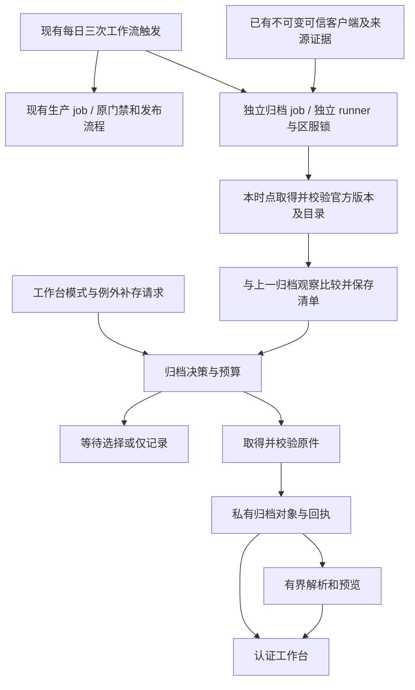

# 官方更新档案设计

状态：用户已确认总体方向；已完成默认自动保存、工作台集成、更新隔离，以及“双服共用 2 GiB、保留最近 10 天、FIFO 与手动清理”的设计修订。未实现、未修改生产配置、未做云端验收。

日期：2026-10-20。源码核对基线：`2e6f3a2`。

## 1. 已确认的方向

- 复用现有北京时间 **09:00、14:00、19:00** 的每日三次检查；每次检查已启用的 Global、JP 区服。不增加轮询、监控服务或新的自动触发时间。
- 默认行为是：每天三次检查发现新的热资源或 Master 内容后，符合预算就直接下载、校验并保存，不等待管理员查看、勾选或登录工作台；普通客户端更新的变化文件同样按规则自动保存。
- 网站生产与归档在不同 runner 独立运行，用户明确接受重叠资源可能分别向官方下载。首版不增加跨机器的原件下载协调、共享下载锁或“生产必须先搬文件给归档”的依赖。
- 活动周期用于分组，不决定检测边界，不按十天重置基线，不以活动开放时间过滤资源。
- 大版本或单文件/保存单元超出自动阈值时保留变更清单，转为管理员手动选择保存；全局总空间不足则自动按 FIFO 汰换旧档案，不能把所有新更新转成等待人工清空间。
- Global、JP 共用一个归档总容量，硬上限 **2 GiB（2,147,483,648 字节）**；保留最近 **10 × 24 小时** 内发现的更新内容，超期清理。该上限约束当前保有量，不是每服额度或十天累计下载配额。
- 工作台提供手动清理；FIFO 和手动清理都只处理归档内容，保留必要的最小检测基线，不改网站生产数据或现有每日三次调度。
- 入口作为现有 **Our Notes 管理工作台** 的一个模块，复用导航、认证与站点上下文；工作台负责查看结果和处理例外，不是每批资源下载的启动器。
- 原始文件归档与预览生成分开；未知文件和解析失败文件仍可保存原件。
- 本次只整理设计，不进入实施、发布或生产数据操作。

## 2. 目标、范围与限制

### 2.1 使用场景

一个活动期间，官方先发布新客户端，再发布数次热资源。网站正常更新已支持的卡牌、歌曲、剧情等资料；更新档案另外保存官方本次新增或替换的文件，包括暂时没有页面、没有 Master 关联、尚未开放和无法识别的内容。

管理员可以回答：

1. 今天三次检查分别看到了什么版本？哪些检查失败或没有执行？
2. 这次增加、修改、移除了哪些文件？哪些原件已保存，哪些等待选择？
3. 哪些内容能直接预览？哪些需要下载到本机继续解包？
4. 某张图片或某份配置是在哪一批首次发现、后来又在哪一批修改的？

日常体验类似游戏登录时取得新版资源清单并下载差异：检查触发后自动取得内容，管理员之后打开工作台即可查看。这里的“保存”首先是保存官方原始文件或容器，图片和试听等预览随后生成；不以管理员打开页面或预览完成为条件。

例如：09:00 发现 30 MiB 新热资源就自动保存；14:00 发现大版本客户端时，该客户端包进入待选，但同次已取得可信目录中的 12 MiB 小热资源仍自动保存；19:00 某热资源保存单元有 700 MiB 时，该单元等待选择，其他预算内 Master 单元照常自动保存。第二天的新小更新继续自动保存，无需先处理完昨天的大包。

### 2.2 首版范围

包括：双服分别记录、共同限额的归档；资源目录、Master 和客户端包内文件的变更记录；原件保存；活动分组；2 GiB 总量与 10 天保留窗口；全局 FIFO 和手动清理；例外手动选择；图片、文本和支持格式音频的预览；原件及选中文件导出；解析状态与失败诊断。

不包括：更高频检查、历史版本全量补档、任意官方隐藏地址发现、完整客户端还原、通用反编译、执行热更新代码、任意模型在线运行、自动判断所有未公布活动、把归档内容自动发布到公开网站。

### 2.3 可观察范围

- 只承诺记录实际检查时能取得的官方版本。两次检查之间被替换且撤回的版本可能漏掉。
- 发现时间表示本站首次观察时间；没有明确上游时间时，不推测官方上传时间。
- 官方目录没有列出、客户端包中也不存在的文件不在发现范围。
- 沿用现有官方版本信号决定何时重新取得目录；上游不改版本信号却原地替换文件时，不承诺在该次轻量检查发现。实际重新取得材料时，摘要冲突须明确报错，不能覆盖旧证据。
- 只比较文件声明和字节内容，不承诺识别“下个版本”“下期活动”的业务含义。有关联证据时展示关联；否则显示未关联。
- 调度时点沿用现有策略。记录计划检查时点与实际开始时间；不把 GitHub 调度时间当成保证执行或发布的期限。

## 3. 当前源码基础与需要新增的边界

本节是本地源码结论，不代表重新核验了线上部署。

| 现有入口 | 可复用能力 | 设计中的补充 |
| --- | --- | --- |
| [content-r2.yml](../../.github/workflows/content-r2.yml)、[r2_schedule.py](../../tools/r2_schedule.py) | 双服每日三次检查、同服串行、不取消运行中的任务 | 在同一次工作流触发下增加独立归档 job，与生产 job 隔离锁、runner 和状态 |
| [global_remote_sync.py](../../tools/global_remote_sync.py) | 完整目录记录、变更计划、Master 比较、原始下载与预算 | 将混合的新增/修改状态细分，持久化归档批次和待保存文件 |
| [jp_remote_sync.py](../../tools/jp_remote_sync.py) | 版本绑定的目录/Master 快照、资源身份、校验后下载 | 补充 JP 的归档比较和全类型变更保存，不能直接套用 Global 的地址规则 |
| [current_resources.py](../../tools/current_resources.py) | 按需下载、缓存校验、Unity 解码和部分对象提取 | 从网站所需对象扩展为归档任务，但保留网站生产接口的职责 |
| [r2_production_gate.py](../../tools/r2_production_gate.py)、[jp_update.py](../../tools/jp_update.py) | 网站生产的可信无变化判断、轻量恢复和生产源码指纹 | 归档另有进度及源码边界；上线改工作流会使现有回执失效，不能声称完全没有生产成本 |
| [r2_run_record.py](../../tools/r2_run_record.py)、[update_health.py](../../tools/update_health.py) | 按生产 job 记录运行回执，独立判断定时执行和交付健康 | 归档写自己的结果，不覆盖生产回执或刷新生产成功时间 |
| [r2_state.py](../../tools/r2_state.py) | 私有不可变对象和条件指针写入的实现基础 | 归档独立命名空间和索引，不把历史档案放入日常完整恢复集合 |
| [backend/admin/app.py](../../backend/admin/app.py)、[admin.mjs](../../backend/admin/static/admin.mjs) | 私有认证工作台、只读预览模式、生产状态展示 | 新增更新档案入口、受认证的文件读取与归档操作 |
| [resource_classification.py](../../tools/resource_classification.py) | 基于证据分类，未知关系保留待确认 | 分类用于检索和预览，不能用公开发布允许清单过滤归档原件 |

知识图谱覆盖核对显示 `tools/`、`docs/` 和管理静态资源目录被当前索引排除；上述相关结论使用定向源码读取补足。没有以图谱未命中推断功能不存在。

## 4. 总体方案

选择“记录每次观察 + 保存增量原件 + 派生预览”。只留清单无法抵抗上游撤回；每次保存全量快照会放大存储和恢复成本。



生产 job 和归档 job 共享现有三个触发时点，各自在独立 runner 中执行，彼此没有完成依赖。普通新资源在归档 job 中自动保存。归档失败不能取消正常网站更新；网站构建、公开上传或晋级失败也不能阻止归档独立探测和保存。工作流总体状态可能因任一 job 失败而失败，但生产交付结果与归档结果分别呈现。

可复用私有存储中已有的不可变可信客户端、目录及回执，但不等待本次生产写入新 checkpoint，不把归档前置到生产之前，不通过共享本地缓存或生产锁传递材料。两项任务在同一时点可能各自执行必要的只读官方请求；这仍属于每日三次执行，没有额外轮询。执行开始时间不同、上游切版时，两项任务可观察到不同版本，分别记录身份，不强行拼成同一快照。

用户已确认采用独立运行的取舍：检测阶段主要取得版本与清单；网站生产随后下载其需要的文件，归档独立下载需要保存的变化文件。同一文件如果两边都需要，允许分别从官方获取，不要求实现全系统只下载一次。归档自身仍复用已验证的归档对象并保持幂等，不能把允许跨任务重复获取理解为每次检查都重下全部历史。

已有私有持久化材料的复用仅是可用输入的核验读取，不引入本次生产/归档之间的实时原件缓存、互相等待、跨机器搬运或下载所有权协议。两边各自执行网络和校验预算；双服归档共用 2 GiB 的容量账本只协调归档存储，与网站下载任务无关。

凭据、可信客户端和官方探测本身失败时，如实记录失败，不伪造可用快照。两项任务间的边界及尚存的资源竞争见第 10 节；不承诺新增归档没有任何账户级开销。

## 5. 数据模型与身份

### 5.1 三类核心记录

| 记录 | 主要字段 | 用途 |
| --- | --- | --- |
| `CheckAttempt` 检查记录 | 区服、计划时点、实际起止时间、运行 ID、探测结果、来源快照引用、分阶段结果 | 每次运行都记录；无变化或失败也可观察 |
| `SourceSnapshot` 来源快照 | 区服、客户端版本/身份、资源版本、catalog 摘要、Master 清单摘要、客户端文件清单引用、可信材料引用 | 固定一次实际观察到的来源证据 |
| `ArchiveBatch` 更新批次 | 来源快照、比较基线、变更清单、文件归档状态、决策原因、保存尝试与预览引用 | 同一来源重跑不重复建批次；一个批次可多次补存 |

活动分组 `ActivityGroup` 独立保存名称、区服、可选活动 ID、展示起止时间、批次成员与修订号。改分组不会改变来源身份、文件状态或检测基线。

### 5.2 文件记录

每项保存：

- 来源类别：`remote_asset`、`master` 或 `client_entry`。
- 官方地址键或包内相对路径、原始名称、provider/资源类型、声明大小与上游 hash 及其算法。
- 变更类型：`added`、`modified`、`removed`、`metadata_changed`；保存前后引用。
- 下载后的实际字节数、本站 SHA-256、校验方法、不可变对象引用。
- 所属更新首次发现时间 `firstObservedAt`、首次入库时间 `firstArchivedAt`、过期时间、清理状态和清理原因。
- 网站收录证据（收录/未找到对应映射/暂未核对）、可选实体关联及证据。
- 归档状态、失败原因、来源可获取性、解析状态和解析器版本。

目录 hash、HTTP ETag 和本站 SHA-256 是不同字段，不能互相冒充。没有可验证内容摘要的上游记录，必须保留其可信目录绑定、实际下载证据及本地 SHA-256，界面不能宣称具有上游未提供的摘要认证。

### 5.3 身份与幂等

- 来源身份由规范化的区服、官方版本/包观察身份及实际取得的 catalog/Master 清单摘要产生，不包含检查时间、源码提交或活动分组。
- 尚未取得可信目录、只收到“客户端需要升级”信号时，先记录在 `CheckAttempt` 中，显示“发现客户端更新，目录未取得”；不建立可比较的完整来源快照，不推进基线。
- 客户端详细清单可以晚到，作为来源快照的不可变补充证据。清单修订单独编号，不覆盖已接受证据。
- 观察进度按热资源、Master、客户端包三个来源分别维护。客户端清单未取得不阻止已有可信热资源/Master 推进；不能拿缺失的客户端清单与空清单比较后把全部文件报为新增。
- 同一来源和比较基线对应同一批次；重跑增加尝试记录。文件以 SHA-256 去重，引用不依赖临时 runner 路径。
- 仅修改归档解析器时，可重建预览；不能制造一批“官方更新”。
- 内容条目因 FIFO、到期或手动清理删除后，保留有界的清理墓碑，不把它重新当作下载失败。只有窗口内的新更新确实引入新条目，或管理员明确重新补存，才重新取得；查看、重新分组、重建预览不改变过期时间。

## 6. 如何比较更新

### 6.1 热资源

比较完整可信 catalog 中的资源，不按网站当前支持的资源类型筛选。使用区服适配器提供的稳定资源键；不能确认稳定对应关系时保守记为旧项移除、新项增加。

- 新键：新增。
- 同一稳定键的内容 hash/大小变化：修改。
- 仅地址目录、provider 等元数据变化，内容 hash 和大小不变：元数据变化；仍需验证可复用身份。
- 旧键消失：移除。保留旧归档，不下载不存在的新文件。
- 所谓“改名”只有明确关系证据才展示，否则不猜测。

先保存官方容器级差异；解析后再生成容器内图片、文本、音频等对象清单。不能把一个 bundle 被替换等同于其全部内部图片都改变；未完成对象比较时明确显示“容器变更，内部差异未解析”。

### 6.2 Master 数据

比较完整 Master 清单，保存新增或改变的原始文件。解密支持时另存结构化预览。JSON 差异忽略对象键顺序，不擅自重排数组或猜测业务主键；只有明确契约的表才提供按记录 ID 的增删改摘要。

### 6.3 客户端包

沿用现有包名、版本、签名及分包身份验证。验签通过后，对 APK/分包内普通文件生成路径、解压后大小和 SHA-256 清单，比较新增、修改和移除；ZIP 时间戳、压缩方式变化不单独视为资源内容变化。

首版客户端归档单位是包内文件。普通更新在取得可信新旧文件清单后，变化文件默认自动保存；只有大版本、规模未知或超限的对应部分需要手动选择。完整 APK/XAPK 不默认永久保存，是单独可选项，按完整大小预算；已有私有持久化可信包可核验后复用，其他 runner 的本地包不作为跨任务可用输入。包内变化文件集合不能宣称可重建完整可安装客户端。

包很大且尚未下载时，先显示官方包身份、已知大小和“内部清单未取得”。大版本不为归档单独自动下载大包来换取清单；管理员可选择“获取包并分析”，已持久化的可信包则可直接分析。因整包下载才能提取一个文件，工作台必须同时显示预计归档大小和实际需要取得的容器大小。获取/分析包与保存其全部变化文件是两种授权，后者不能由前者隐含扩大。

读取压缩包须限制条目数、总展开大小、单条目大小、压缩比例和工作时间，拒绝路径逃逸、重复冲突路径和链接条目。异常包不影响现有可信客户端基线。

### 6.4 初次启用

首次运行从当前可信目录建立基线，显示“归档从本次开始”。不把全目录算作新增，不自动补下全部历史文件。

客户端文件基线优先使用现有已验证包；材料缺失时客户端比较单独显示“未建立基线”，等待明确选择取得当前包，不影响热资源与 Master 归档。后续客户端基线缺失的更新属于未知规模，转手动处理。

## 7. 发现进度与保存进度

必须分开维护：

1. **最后可信观察**：目录、差异清单和批次已在私有存储提交后，才可推进。它用于下一次比较。
2. **文件保存进度**：按批次、按文件维护，不能用“上次成功归档版本”这一单值替代。

例：A 为已建基线；14:00 发现 B，因超限等待选择；19:00 发现 C。

- C 与 B 比较，避免重复将 B 的大量内容列为新增。
- B 的待选文件继续存在，不能因 C 出现或网站已更新而消失。
- 仍在 C 中、此前因暂时性预算/中断未存的 B 文件，继续保留自动补存资格；不能因为它在 C 中是“未变化”就从队列消失。等待人工决定的项仍保持待选，不因 C 出现而偷偷自动保存。
- 处理 B 时固定使用 B 的来源身份；旧地址失效则标记不可取得，不能拿 C 的同名文件冒充 B。
- 已有可信同内容对象可复用；复用同样核对身份和回执。
- 本轮差异清单写入失败时不推进观察基线。下一次从旧基线重试，并记录存在观察缺口。
- 上游版本回退也记录为新的观察转换，不因回退额外清理档案；历史是否仍有原件由 10 天窗口和 FIFO 决定。相同版本身份回到历史来源时复用仍存在的快照，以本次比较基线建立相应转换批次。

批次按下列三轴展示，避免“已完成”掩盖缺项：

| 维度 | 状态 |
| --- | --- |
| 发现 | 已记录 / 发现失败 / 清单未取得 |
| 决策 | 自动 / 等待选择 / 仅记录 / 已明确跳过 |
| 保存与预览 | 当前可用 x/y、历史累计保存数量、自动待续、部分失败、来源失效、FIFO 已汰换、到期已清理、手动已清理；预览另列待生成/可用/部分可用/不支持/失败/已清理 |

“选择的文件已保存”与“本批全部变化文件已保存”分别显示。普通自动保存无需有任何手动请求。暂时性资源不足使用 `deferred_auto`（自动待续），需人工决策使用 `waiting_manual`，二者不得混用；恢复条件见第 9 节。下载失败自动重试次数用尽后保留为待人工处理；人工跳过不自动重试。

## 8. 活动分组

- 每服独立设置当前默认分组；管理员可新建、重命名、结束分组，并调整批次归属。
- 没有默认分组时进入“未分组”，不阻止归档。结束分组后不按十天自动开组。
- 一个更新批次只有一个主分组，内部文件可另有多个有证据的活动/实体标签，避免整批内容被错误归给单一活动。
- 分组按本次更新发生的观察背景整理，不代表文件一定属于这个活动。提前放入的下期内容照常保存。
- 移动批次不复制对象、不重算检测基线、不触发下载；统计按去重对象与逻辑文件数分别展示。
- 容量保护独立于可编辑分组，避免改名、拆组或开新组重置预算。

## 9. 保存策略、大版本与容量

### 9.1 每服模式

| 模式 | 每日三次检查的动作 |
| --- | --- |
| 自动保存（默认） | 发现内容即自动下载和保存，无需查看或确认；只有大版本或超限的对应保存单元进入例外处理 |
| 仅记录清单 | 保留检测和差异；不因归档额外下载原件、不生成新预览 |
| 手动选择 | 所有新批次先进入待选，管理员选择后排队保存 |

手动请求可以授权保存旧批次；全局“仅记录清单”是暂停归档文件取得与新预览，暂停时已有请求也显示暂停，必须恢复模式后执行。暂停不回滚当前已校验提交的文件；执行器在每个文件开始前重读策略版本。

“手动选择”是管理员主动切换的特殊模式，不作为默认产品流程。恢复自动模式时，暂停期间窗口内、未明确跳过/清理、未触发人工门槛且仍可取得的内容，在后续三次时点自动补存；大版本/超限待选、已跳过或已清理项不会被恢复模式隐含批准。超过 10 天的待续项标为过期，不再自动下载。历史补存预算不挤占新内容预留。

### 9.2 大版本判定

首版采用确定规则，不猜测市场宣传中的“大版本”：

- 客户端数字版本的主版本或次版本变化，例如 `1.0.x → 1.1.x`。
- Unity 版本、解码材料绑定或包结构发生不兼容变化。
- 新客户端版本无法解析、缺乏可比较的可信旧包，规模未知。
- 管理员将某个客户端版本显式标为需要手动处理。

规则按来源隔离：客户端大版本标记约束该次客户端包的保存单元，不自动阻止同次检查中可信、可比较且预算内的热资源和 Master 保存。热资源本身大到超限时再由其容量规则进入待选。只改变补丁号的普通客户端更新不因版本号本身触发大版本规则，仍受容量限制。

签名、身份校验失败属于“可信输入被阻断”，手动选择不能绕过校验。包验签通过但资源解码方式不支持时，可以按保存策略留可信原件，预览标为不支持；只有连版本/目录都无法验证取得时，才阻断依赖这些材料的来源，不能一概写成“解码失败则任何原件都不许保存”。

大版本待选固定到该次客户端更新及其明确列出的文件，不设置“整个新客户端后续所有热更等待确认”的常驻开关。建立可信新目录后，后续预算内的小热更继续自动保存；大版本待选文件仍留在原批次。如果目录重建后缺乏可信旧目录，先记录“比较基线缺失”，通过新基线或明确选择恢复，不把全目录假装成一次小增量。仅版本号和目录布局变化、内容身份未变的资源不应重新下载。

### 9.3 容量硬约束与执行预算

双服合计 2 GiB 和最近 10 天窗口是用户明确约束，不是待测建议值。其余单文件、保存单元、传输和预览限额是尚未经真实归档流量测量的执行初值；调整它们不能突破总容量或延期保留。单位按二进制计算。

| 项目 | 建议值 | 超出后的行为 |
| --- | --- | --- |
| 单个自动保存原件 | 256 MiB，与区服适配器硬上限取较小值 | 对应文件转待选；传输硬上限不能由手动确认绕过 |
| 一次观察中同来源自动保存单元的新增原件 | 512 MiB | 对应单元转待选；其他来源单元可继续自动保存，界面明确显示部分覆盖 |
| 双服共用归档总存储 | 2 GiB | 先按全局 FIFO 释放旧档案，确认实际释放后才准入新对象；不能临时超额 |
| 归档内容保留窗口 | 最近 10 × 24 小时 | 每次既有归档执行先清理过期条目，不新增清理定时器；跨过期时点后立即不可下载，在下一既有执行物理回收 |
| 单次执行归档下载量 | 2 GiB | 剩余工作留待下次检查；单个不可分割容器超限则等待调整配置 |
| 单批派生预览新增存储 | 64 MiB | 原件继续保存，其余预览标为预算暂停 |

“保存单元”按来源拆成热资源、Master、客户端包；单个文件超限时先单列该文件，其他可自动文件另算单元规模。管理员不能通过任意拆批绕开总容量。现有 JP 下载器限制是 256,000,000 字节，比 256 MiB 更小；实现须展示有效上限，超过传输契约的文件只能使用另行审核的有界获取能力，不能放宽现有网站下载器。

预算区别：目录中变化文件的逻辑大小、需要从官方取得的容器/依赖字节、实际新增存储字节。全量清单先报告逻辑规模；只有已有对象经过可信身份和字节证据核对后才扣除可复用字节，未知项保守按完整大小计算。

手动保存可越过自动单文件、单保存单元阈值，但请求必须给出具体选择和本次批准的下载/存储上限。双服 2 GiB 总量、10 天窗口、每次执行的硬下载上限和磁盘空间下限仍有效；界面不能用“强制”按钮绕过它们。重试、完整包获取、依赖取得都消耗实际下载预算；复用已验证本地字节不重复计下载量。十天内的累计传输可以超过 2 GiB，只要当前保有量始终满足总上限，避免把存储限额误做成下载限额。

单次下载量计入归档专用的官方获取、私有对象恢复和上传后读回校验的接收字节；失败尝试收到的字节也计入。已有生产对象虽然可以避免向官方重复下载，但独立归档 runner 从私有存储接收它的字节仍要记账，不能假装是可直接访问的另一个 runner 本地文件。新增归档对象的读回另需预留预算；已可信取得且本 runner 仍持有的同一份字节不因多条引用重复计数。预算不足完成单个对象的获取与验证时，不开始该对象。

2 GiB 内预留 64 MiB 给控制、索引、基线与检查诊断，这些字节也计入总量，不可当作额外赠送空间。原件、预览、必要解码上下文、历史索引、未引用上传对象和在途写入预留都纳入同一账本；没有另设每服 2 GiB 或 10 GiB。重建索引等需要新旧控制对象暂时并存时，同样先预留实际峰值，不能忽略控制对象换代产生的占用。

空间不足优先执行第 12 节 FIFO，而不是一律暂停或要求人工释放。不可分割的新对象及其必需上下文连最小控制状态一起就大于 2 GiB 时，拒绝该项并显示“单项无法容纳”，不能删光其他内容再发现仍然放不下。没有足够可回收对象、对象正在读取或删除失败时暂缓该项；不降低网站生产既有容量门槛。目录本身超过控制对象界限时记录明确失败并维持旧观察基线。

### 9.4 超限后的状态与恢复

| 原因 | 状态与影响范围 | 恢复方式 |
| --- | --- | --- |
| 大版本、单文件/保存单元过大、客户端规模未知 | 对应项 `waiting_manual`，其他预算内来源照常自动保存 | 明确选择、跳过，或管理员明确将新的自动上限应用到该批；普通配置回写不隐含批准旧待选 |
| 单次下载/时间预算用尽 | 窗口内项 `deferred_auto`，保留自动资格 | 下一次既有检查重新核算后自动续存；过期或已清理项不续存 |
| 双服总空间不足 | 先到期清理，再全局 FIFO，释放成功后自动保存新内容 | 只有无法回收、删除失败或单项无法容纳才暂缓/报错；不要求普通新更新逐批点击 |
| 归档 runner 资源不足 | 受影响归档写入暂停，仍尽量保留有界清单；网站生产不变 | 归档资源恢复后，下次检查自动恢复窗口内未触发人工门槛的项 |
| 网络暂错/可恢复中断 | 自动待续并保留尝试 | 按第 10 节次数自动重试，超过次数转待人工处理 |
| 来源撤回、旧身份无法验证、签名失败 | 明确失败，不换成新版同名文件 | 仅可提供可核验的旧来源或明确跳过，不能强制伪造成功 |

总容量由一个跨双服的账本记账，不按活动分组或区服重置。自动、手动、预览和清理共享该账本，预留尚未完成的写入；失败上传留下的对象、未完成分段上传的预留在实际回收前不能从占用中扣掉。重试、去重、批次移动不能反复扣减或绕开统计。

## 10. 对现有每日三次更新的隔离与执行流程

### 10.1 编排与资源边界

1. 保留现有一份 cron、09:00/14:00/19:00 三个时点及 `produce` job 的区服选择、生产锁、超时、轻量门禁和公开晋级条件。同一次工作流触发增加 `archive` job；两个 job 不设置相互 `needs`，不同区服仍互不因失败取消。双服归档只在全局容量准入/清理提交时短暂协调，不能把此协调锁扩展为生产锁。
2. 归档使用独立 runner、独立临时目录、独立 `content-archive-<region>` 并发组；不占用 `content-r2-<region>` 锁，不写生产 workspace、checkpoint 指针或公开指针。归档任务长时间下载或解析不能在同一生产 job 中排在生产步骤之前或之后延长其持锁时间。
3. 归档初始建议总时限 20 分钟，其中预览最多 3 分钟；原件阶段预留最终提交时间，在到期前将剩余工作记为自动待续。归档超时/异常只使归档 job 失败，不能取消已开始或尚待执行的生产 job。工作流整体被人工取消或账户级故障仍可能影响两项任务，不能宣称平台级绝对隔离。
4. 归档拥有独立的 CPU、内存、磁盘、网络并发和下载预算。启用前验证账户并发额度、所选 runner 容量、私有存储请求配额与官方访问限流，至少满足两服生产所需的既有容量再接纳归档。没有足够余量时保持归档关闭，不用降低生产并发/预算来迁就归档。这个条件必须在部署接入前成立，不能依赖“归档 job 抢到 runner 后再退出”冒充为生产预留名额；若共享账户无法保障余量，需先提供有容量保障的执行资源或延后启用。上线前实际测量双服并发与日常无变化耗时；独立 job 仍有账户级开销，不能只靠“独立”二字声称零影响。
5. 最小恢复仅取得已固定不可变生产清单中的必要可信材料，不恢复全部历史、不改生产状态。同次生产的新包尚未私有持久化时，归档可在自身预算内独立获取并验证，或记录客户端材料待取得并在下次检查自动重试；不能强迫生产提前 checkpoint 或等待归档 pin。需要人工决定的大包保留待选。
6. 生产无变化门禁只决定生产恢复/构建；归档独立判断来源变化、初次基线、未完成原件、补存请求和预览。归档待办不能迫使 `produce` 走完整恢复；生产失败也不使归档 job 跳过。两边探测到不同来源时，工作台分别显示各自版本。

### 10.2 归档 job 内的执行顺序

1. 取得归档区服锁，记录计划时点和实际开始时间，读取自己的策略、分来源基线与请求修订；每个时点只入队一次，重跑使用幂等身份。认领已确认手动清理请求及过期清理，进行有界回收；全局清理请求由任一已启用归档 job 认领，不要求被清理区服当次也启用。清理未完成不得阻止新目录的读取与记录。
2. 每次都先按既有官方版本信号探测新内容，不能仅因历史补存积压就跳过本次发现。来源变化时校验并保存 catalog/Master 清单及可取得的包证据，再按来源提交观察进度。没有变化、没有归档待办且当次到期/清理检查已完成时轻量退出；“仅记录清单”模式仍执行既有档案的到期清理和已确认手动清理，不暂停生命周期管理。
3. 对可信的小更新直接创建自动保存任务并执行；没有“等待管理员查看”这一前置状态。大版本或大小未知的对应单元按第 9 节处理，不影响其他可自动单元。
4. 先保存本次新原件，接着轮转处理旧自动待续和已批准的手动补存，最后才生成预览。2 GiB 单次接收预算内，先扣除实际控制材料开销；余下额度新、旧各预留一半（各最多 1 GiB，包含获取和读回），各自没有工作时可借用对方剩余额度。20 分钟总时限内，控制探测和最终提交合计预留 3 分钟、原件阶段最多 14 分钟（新、旧各预留 7 分钟，可借用空余额度）、预览最多 3 分钟；控制耗时超出预留则压缩归档工作，优先保留最终提交时间。历史队列按提交时间轮转，避免一个大请求永远独占。
5. 原件按文件校验提交；在独立 runner 本地取得并校验新文件之后，才为上传申请全局空间，必要时按 FIFO 回收旧档案并确认释放，再预留、上传、读回及提交，避免上游下载失败也先汰换旧内容。任务预算不足以完成某个不可分割容器和必要验证时，留待下次或要求明确调整归档执行上限，不启动注定超限的下载。部分完成可恢复；新单元估算因运行时错误未全部完成时显示真实部分覆盖，不回滚已保存文件也不称整批成功。
6. 同一对象被本次自动任务和历史手动请求同时引用时，归并为一次取得/上传；按校验完成的引用更新两边进度。取消一个请求只移除它的待执行引用，不取消仍被另一自动任务需要的对象。
7. 生成有界预览、提交归档独立回执。所有图片解析与试听转换排在原件之后，原件无需等待解析完成。预览只使用原件之后剩余的全局额度，不为新增缩略图或试听文件主动汰换旧原件；空间不足显示预览预算暂停。未完成预览只在后续既有时点继续处理，来源已清理或过期则终止，不延长生产 job。

新旧比例为初始防饥饿规则，正式值依据测量调整；当当次所有任务共同超过硬预算时，不承诺都在本次执行完成，但不得丢队列、跳过新清单或要求正常小更新逐批确认。

### 10.3 回执、健康与源码指纹

现有 `content/operations/<region>/latest.json`、生产运行阶段和 `lastSuccessAt`/`lastScheduledAt` 由 `produce` job 继续独占写入。归档写自己的命名空间与健康状态，不能使用工作流总体结论覆盖生产状态，不能以归档成功掩盖网站失败，反之亦然。工作台原“内容发布”模块仍显示生产交付，“更新档案”模块显示归档状态。

当前生产指纹包含整个 `tools/` 的指定源码及 `.github/workflows/content-r2.yml`。接入独立归档 job 的工作流改动会使旧生产回执失效：上线后两服首次可能进行一次完整恢复/生产，必须按原门禁接受并验证，再证明后续无变化恢复轻量路径。不能为了消除这次开销放宽门禁或忽略真实生产依赖。

归档专属实现与解析配置应放在独立的归档模块目录、使用独立指纹和运行时版本，不默认塞进生产全量扫描的 `tools/` 树；禁止生产反向依赖归档模块。若确需增加精确的运维叶子排除，必须验证依赖边界，不能扩大目录级排除。共享传输/解码工具的真实变化仍应使生产指纹失效。归档专用转换依赖不能要求网站生产每次更换镜像。

官方正常版本探测中用于一致性校验的请求及同次有界网络重试继续保留；不因此新增跨时点自动探测。每个下载文件每次在首次尝试之外最多重试两次，自动待办最多跨三次实际开始下载的检查尝试，之后转为人工处理；仅排队或预算不足未执行不消耗该次数。维护或来源版本变化不伪装成无变化。

## 11. 手动选择如何执行

手动流程只处理例外或管理员主动选择的历史内容。正常小更新不经过本节，不需要登录、勾选或确认。工作台负责保存请求，执行器运行在独立归档 job 的 runner。

- 操作：选择整批/目录/文件、获取客户端包并分析、跳过选中项、重试失败项、重新生成预览、修改模式、调整分组。
- 选择包内文件时，系统展开必需的原始容器和可确定依赖，展示总下载预算；未知依赖只报告，不能静默扩成全量下载。“获取包并分析”只批准取得已固定身份的包与分析，不自动批准保存所有包内变化；分析结果在工作台出现后仍按大版本/容量策略处理。
- 提交后显示“已排队，将在下一次现有检查中处理”。页面点击不启动新轮询、不在服务器运行解包、不自动派发 GitHub 工作流。
- 需要更早处理时，管理员仍可自行使用现有 Actions 手动运行入口；不新增自动调度。原有 region、shadow/promote/auto 对生产 job 的含义不变，归档不读取它们作为发布授权；归档始终不能晋级公开内容。所有额外手动运行都要在检查记录中标为手动。
- 请求固定区服、批次、清单修订摘要、选中项及依赖闭包、预算、申请人和幂等键。“整批/整目录”提交时展开成具体项；后到的客户端清单、新目录项不自动加入旧授权。文件内容清单变了返回冲突并要求刷新；仅保存进度或预览变化不使选择失效。执行期间不得替换成另一批同名文件。
- 请求状态：已排队、执行中、部分完成、完成、失败、已取消、已过期；超时提交按幂等键查询，不重复建请求。
- 同服执行器串行处理；租约和文件成功回执允许进程中断后接手。重复处理只补缺项。
- 仅取消尚未开始的工作，不删除已经成功保存的对象；执行中策略变更在文件边界生效，实际执行策略修订写入回执。

只要旧 URL 仍可获取且能够绑定原批次的内容身份，就继续补存；来源地址可变、又没有足够内容校验证据时标为无法确认旧版，不能把 HTTP 200 当作取回旧文件的证明。新版本的对象只有在明确内容身份及必要校验一致时，才能作为旧缺项的复用证据。版本相同、文件名相同或大小相同都不足以替代旧身份。

跳过待选项只改变这些文件的决策，不停止后续自动归档。跳过或清理后重新补存需要新的明确请求，并且必须仍在原更新首次发现起算的 10 天窗口内；已过期项不可借补存重置保留期。补存完成不修改活动归属、观察基线或网站发布状态，空间仍按双服 FIFO 取得。人工增大默认阈值时，界面区分“仅应用到后续新内容”和“同时批准所列旧待选”，避免策略调整意外批准整个积压队列。

## 12. 存储、完整性与保留

### 12.1 私有对象组织

归档使用独立私有根 `update-archive/v1/`，其下分别存放 `global/`、`jp/` 的档案与一个共用的容量/清理控制目录。可复用现有私有桶，前提是部署配置明确接入且权限能够限定到归档根；不创建公开访问入口。

```text
global/objects/sha256/<digest>          Global 原件与派生对象
global/snapshots/<source-id>/...        不可变来源证据与客户端清单补充
global/batches/<batch-id>/...           不可变差异、进度与解析回执
global/checks/<check-id>.json           检查结果
global/requests/<request-id>/...        手动补存及执行回执
global/views/...                       分页索引与分组视图
global/control/...                     模式、分组、最小基线和视图引用
jp/...                                 JP 的对应数据
control/quota.json                     双服共用占用、写入预留及修订
control/cleanup/<request-id>/...        手动/FIFO/到期清理计划与执行进度
control/tombstones/...                 有界清理墓碑，防止自动补回
```

对象去重按区服命名空间进行，同一区服对象只计一次物理大小，跨区服两份对象分别计入共同的 2 GiB。预览身份包含原件摘要、解析器版本及转换选项；更新解析器不覆盖旧结果，但旧结果仍计量并受同一保留/汰换规则约束，不能无限叠代。索引分页，按需获取；不在工作台首次打开或每次 runner 启动时遍历并下载全部对象。

所有原始对象上传后完整读回核对大小和 SHA-256，才写“已保存”回执并提交引用。历史可信回执可作为复用证据，证据必须绑定当前存储对象身份；不以 key 名、大小或 ETag 单独代替内容校验。提交索引使用条件写入，冲突后读取最新修订并重放，不覆盖他人的分组或策略修改。

控制配置与执行进度使用不同对象，避免 runner 更新状态时覆盖管理员操作。中断产生的未引用对象不自动标为档案；后续重试可核验后复用，或在有界恢复核对后回收；它们在回收前仍占全局额度。

双服上传、预览和手动操作通过同一 CAS/带 fencing 的短租约申请容量，满足 `已占用字节 + 未提交写入预留 <= 2 GiB`。申请前必须计入控制对象换代与实际新增上下文。容量锁不跨越官方下载、解包或生产任务；清理计划提交后可释放短锁执行删除，但对象保持 `evicting`，其他任务不得在删除与账本提交之间新增引用。下载完成、上传及最终提交引用前均核对条目修订、墓碑与过期时间；清理已经发生时拒绝迟到任务重新提交，已上传而未提交的字节继续记账并回收。并发冲突重读账本重算，不由两服各自看到“剩余 1 GiB”就各上传 1 GiB。

### 12.2 与生产缓存隔离

归档必须拥有自己的持久化对象及引用，不能只指向会被生产 retention 清理的本地缓存。客户端解码所需 metadata、Unity 身份、材料绑定回执和可确定的必需依赖一并持久化或建立独立保留引用，纳入预算；不把明文密钥复制进归档清单。

若所需上下文尚未取得，先保存可信原件，明确标记“上下文缺失，无法保证重新解析”。不为补足预览上下文静默下载完整历史包。完整客户端保留是额外选择，不是首版原件保存成功的前提。

日常生产 checkpoint 不包含全部归档历史，现有 JP/Global 缓存裁剪不能删除归档对象。跨 runner 只能引用已提交的私有不可变对象，不能引用生产本地缓存，也不能要求生产在归档完成前延迟裁剪。归档取得对象后建立自己的持久化对象和上下文引用；后续生产清理自身临时目录不影响这些引用。为归档额外复制或延长保留的上下文应计入 2 GiB，不能把原件藏进生产状态以绕开限额。归档清理器不得删除生产原始对象或其指针；只持有归档根的删除权限。

### 12.3 保留与清理

保留窗口与全局容量同时生效：内容条目的 `expiresAt = firstObservedAt + 10 × 24 小时`。FIFO 按原件首次成功入库的 `firstArchivedAt` 升序、再按稳定条目 ID 排序，跨 Global/JP 排成同一队列，不按最后访问时间、区服、活动分组或文件大小排序。补存、看图、移动分组或重新生成预览不延后原更新的到期时间。

每次既有归档执行按下列顺序回收，不增加定时器：

1. 认领并执行已确认的手动清理计划，停止其范围内尚未开始的自动补存/预览任务。
2. 清理已过期的原件条目、对应预览与不再被有效条目使用的上下文；待选/待续请求超过窗口也转为过期。过期原件立即在读取接口不可用，物理删除在下一次既有归档执行完成；不能把每天三次执行描述为精确到秒的物理到期删除。
3. 为新原件准入时，如仍不够空间，从双服共同队列头部逐项汰换，直到实际可释放空间足够。一个热资源容器/包内原件及其专属派生结果作为一个清理单元，避免缩略图留着却原件已无从追溯；批次可以部分被汰换，界面逐项显示。
4. 同一物理对象有多个仍有效的档案条目引用时，删除旧引用不释放该对象。继续按 FIFO 处理下一旧条目，只有归档引用归零才删字节；计划须显示预计释放与实际释放，不能按逻辑文件大小虚报空间。最新来源的最小比较基线是必要状态，不能因为它指向的档案原件已汰换就丢掉基线或误判为从未见过。
5. 标记条目 `deleting/evicting`，阻止新读取和新引用；已有下载使用有界读取租约，等租约释放再删。不对待选、待续或历史补存施加永久保留 pin；它们不能阻止 FIFO，引用的条目被清理时更新为已清理并停止自动重抓。
6. 逐对象确认物理删除成功后才扣减占用和批准新写入；超时、权限拒绝或未知删除结果仍按占用处理。清理中断后按计划和墓碑幂等恢复，不因租约过期就假定空间已释放。新文件已在本地校验仍可能在远端上传失败；硬上限不允许新旧远端副本同时越界，因此不能承诺汰换后上传失败还可恢复旧原件。

允许保留必要且有界的最小比较基线、配置和清理诊断用于下一次检测，它们计入 2 GiB；已过期完整历史目录、完整旧客户端和旧媒体不能借“基线”名义长期保留。历史审计信息压缩为有界摘要，空间紧张时按最早记录收缩；活动分组可以留下名称和“内容已清理”的标记。所有不可变历史对象都受生命周期管理，“不可变”表示不覆盖内容，不表示永不删除。

工作台提供“清理选中文件”“清理本批”“清理本分组”“清空归档内容”选项。先按当前修订生成计划，显示区服、范围、文件数、预计真正释放的字节及对补存/预览的影响，再由管理员确认提交；确认不扩大到后到新文件。清空归档内容覆盖所选区服或明确选择的双服原件及预览，保留最小检测基线、配置和有界清理记录，不更改自动保存模式。

手动清理请求写入共用控制队列，在下一次既有归档执行优先处理，页面显示已排队/执行中/部分完成/完成/失败及实际释放量；排队成功不等于立即释放空间。全部归档执行器关闭时明确显示尚无执行时点，不能承诺下次自动完成。清理只影响已固定选择，后续真正的新更新仍按原模式自动保存。

FIFO、到期和手动清理都会生成墓碑并标明原因。自动补存、失败重试和预览不能把已清理内容补回；窗口内管理员明确重新补存可创建新的入库条目，仍受原到期时间与 2 GiB/FIFO 约束。清理的不可恢复性、上游可能撤回旧文件与即将删除的范围在工作台确认页直接说明。本次只定义该功能，未执行任何实际清理。

## 13. 工作台交互

在现有 **Our Notes 管理工作台**（`backend/admin`）侧栏“内容发布”旁增加“更新档案”入口，集成到同一页面壳和认证会话，逻辑路由为 `#archive`。不另建管理站，不放进面向访客的网站工具页。

页面日常主流程是“查看已自动保存的新内容 → 筛选/预览 → 下载到本机解包”。“待处理”只收纳大版本、超限、失败和材料缺失等例外；不把“勾选后开始保存”做成所有更新的默认入口。关闭工作台、未登录或没有默认活动分组，都不影响已启用的自动归档。

复用站点选择与既有布局，但区服 Global/JP 在模块内明确选择；普通访问统计窗口不能隐含切换归档范围。现有管理页有周期性状态刷新，归档视图只刷新轻量概览/任务状态，列表按游标分页，预览按需加载；页面刷新绝不探测官方、触发下载或重新解包。档案模块不可用只影响该模块，不阻断原有内容发布、登录诊断和统计页面加载。

### 13.1 概览与活动分组

顶部显示区服、当前模式、最近归档实际检查、下一计划时点、待选批次数、自动待续数、未完成手动请求数和当前默认分组。空间卡固定显示“双服共用 x / 2 GiB、最近 10 天”，另列 Global/JP 原件、预览、上下文、控制及在途占用；不能随区服切换误显示成每服各有 2 GiB。检查失败或延迟显示实际状态，不用上次成功时间伪装本次完成。网站生产与归档检查分别标明来源，不能用归档最新时间刷新“网站内容已更新”的结论。

空间卡和批次列表提供手动清理入口、已排队清理任务和最近 FIFO/到期清理记录。显示何时到期、预计/实际释放量与失败原因；总空间满后正常小更新应显示“已汰换旧内容并保存”，不是一律提示“请先手动清空间”。

主体按分组展示批次时间线，也可切换全时间线。列表每批显示客户端/资源/Master 版本、首次发现时间、新增/修改/移除数量、变化逻辑大小、已保存数量、待选原因及预览情况。无变化检查进入检查记录，不制造空更新批次。

### 13.2 批次详情

- 顶部：来源版本、比较基线、来源证据状态、文件与存储统计。
- 筛选：新增/修改/移除，资源类型、目录、包来源、归档状态、预览状态、网站收录证据。
- 视图：图片网格和文件列表可切换；混合内容默认文件列表，保留目录树和搜索。
- 多选操作：保存选中原件、获取并分析包、下载已保存文件、跳过、重试、重新生成预览。
- 清理操作：清理选中文件、本批或本分组，进入有具体删除范围和真实可释放量的确认页；全局清空在空间管理中提供，区服范围必须明确。
- 保存前显示所选项、隐式展开的容器/依赖、预计下载与新增存储、触发的预算原因；尚未解析的客户端包不能展示不存在的精确文件清单。
- “网站未收录”只能依据同来源版本的明确发布映射；没有匹配发布证据显示“暂未核对”，不能把映射未知当作确认未收录。

### 13.3 文件详情

显示原始路径、容器及内部对象路径、来源版本、大小、SHA-256、首次发现批次、首次入库/到期时间、前后版本引用、提取方式和失败原因。可切换当前/上一版预览并下载仍存在的各自原件；上一版只有清单时明确标记“旧原件未归档”，已删除则标明 FIFO/到期/手动清理原因，不能继续显示可用下载按钮。

“下载原件”对容器内对象指向已保存的官方容器/包内文件；导出的 PNG、JSON、试听文件标为派生产物。显示关联 Master 条目时附证据，不以资源编号或文件名猜测活动归属。

## 14. 不同文件的呈现

| 内容 | 首版支持 | 降级行为 |
| --- | --- | --- |
| 常见栅格图片及 Unity 可提取纹理 | 缩略图、放大、尺寸、透明背景切换；有稳定对象对应时前后并排比较 | 留原件与对象清单，显示解码失败 |
| 文本、JSON、配置、文本脚本、可提取 TextAsset | 转义文本、格式化、搜索、前后差异；大文件截断并下载 | 编码未知时显示文件信息和下载 |
| 浏览器支持的音频、现有转换器支持的 CRI 音轨 | 点击后加载试听、时长、音轨列表、派生音频和原始容器下载 | 无解码器、密钥不匹配、外部 AWB 缺失时只留原件及原因 |
| 视频 | 首版文件信息和下载 | 转换及在线播放后续增加 |
| Unity Bundle、图集、序列化对象 | 支持范围内列出对象类型、数量、名称和可导出内容 | 未知布局保留二进制与诊断；不承诺完整解析 MonoBehaviour |
| Live2D、Spine、模型 | 文件/依赖列表和已能提取的图片 | 复杂交互预览后续增加 |
| DLL、原生库、其他编译代码 | 文件身份、大小、可识别格式、原件下载 | 不自动反编译，不把二进制当成文本源码 |
| 未知二进制 | 原始信息与下载 | 可选有界十六进制头部；不猜测内容 |

试听不自动播放；列表不批量加载原始大图/音频。预览先核对格式和尺寸，转换在 runner 中有界执行，结果预先生成；管理服务只交付结果，不在 HTTP 请求内执行解包。

每个文件设置转换时限、内存、输出对象数、展开字节和预览存储界限；达到界限则保留原件和已生成结果，状态为部分可用。文本及脚本只转义展示；HTML、SVG 和其他主动内容不直接在管理员同源页面执行，必要时转成安全派生格式，否则附件下载。

## 15. 管理接口与访问边界

以下为逻辑接口契约，不是本次实现：

| 接口职责 | 输入与结果 |
| --- | --- |
| 读取概览、检查、分组和批次 | 区服、分页游标、受限筛选；返回当前视图修订 |
| 读取文件/对象详情和文本差异 | 固定批次、文件/对象 ID；返回元信息及有界预览 |
| 流式读取预览、音频与原件 | 档案对象 ID，支持必要的 Range/HEAD；校验授权、引用和对象身份 |
| 更新模式与分组 | 明确变更、当前修订、幂等键；冲突返回 409 |
| 创建保存/分析/重试请求 | 固定批次与清单修订、明确选择、依赖与预算 |
| 查询或取消请求 | 请求 ID 与修订；返回真实执行进度 |
| 预览清理计划 | 固定区服/双服、具体条目/批次/分组、当前修订；返回范围、引用影响、预计物理释放量与计划摘要 |
| 确认清理与查询进度 | 已审阅计划摘要、修订和幂等键；排队后返回状态、实际释放量，不以提交成功冒充物理删除成功 |
| 导出选中原件 | 仅已保存对象，固定选择与索引修订；生成文件清单和相对路径映射 |

浏览器只向现有认证管理服务请求，不得到桶凭据、解密材料或任意上游 URL 代理能力。管理服务增加专用归档存储适配器，读取档案、写入控制/请求；不授予公开内容晋级和生产状态修改能力。现有迁移资源节点仍保持观察者职责，不恢复旧的本机生产按钮。

部署时若存储服务不能按前缀提供权限隔离，则为归档使用独立私有 bucket 和凭据；不能为复用 bucket 将完整生产写权限交给管理服务。此为上线必须核验的部署条件，不由源码假定已具备。

原件、预览、Range 和导出均经过同一管理员认证；使用 `no-store` 和合适的内容类型。音频增加精确的同源 `media-src`，不放宽脚本策略；未知内容强制附件并保留 `nosniff`。只读演示模式禁止所有写操作。

手动清理是受认证的写操作，沿用来源校验和明确确认；浏览器不能提交任意对象路径。已过期/清理原件返回明确的不可用状态，不能由下载接口触发自动补存。下载及导出创建有界读取租约，租约只保护正在读取的字节，不能永久占用 FIFO 空间；清理计划变更后需重新读取实际引用状态。

选中下载默认流式生成有界 ZIP，附 `manifest.json`、原始相对路径和摘要。包路径和跨容器同名文件需安全映射避免覆盖；超过导出上限分组下载，不在服务器磁盘长期堆积整批 ZIP。未归档项不能在下载请求中偷偷转成官方抓取。

## 16. 建议模块边界

| 组件 | 对外职责 | 不应承担的职责 |
| --- | --- | --- |
| 区服来源适配器 | 从可信输入提供规范目录、Master/包身份、受限获取接口 | UI、活动猜测、公开发布 |
| 归档比较器 | 比较两个固定快照，产出确定差异和可验证引用 | 下载、数据库写入 |
| 归档策略 | 结合模式、版本规则、预算和手动授权产出决策 | 绕过可信输入验证、删除旧档案 |
| 归档存储与日志 | 不可变对象、摘要校验、分页索引、条件提交、引用保留 | 恢复整个生产工作树 |
| 全局容量与清理器 | 双服 2 GiB 账本、写入预留、10 天到期、FIFO、手动计划、读取租约及墓碑 | 删除生产输入、用独立区服账本超卖容量、永久 pin 历史档案 |
| 归档执行器 | 同一触发下独立 job 处理文件/请求、限额、幂等重试和回执 | 持有生产锁、修改生产 checkpoint 或公开指针 |
| 预览转换器 | 原件及上下文转为有界预览与明确状态 | 把失败当成功、执行输入代码 |
| 管理归档适配器与页面 | 认证检索、查看、选择、下载、保存/清理请求和模式管理 | 在 Web 进程解包、删除生产对象、持有 GitHub 写入权限 |

实现时优先使用现有摘要、传输、客户端验证和媒体转换工具，不把现有大型生产入口继续扩成兼管全部档案的单一模块。具体文件划分留给单独实施计划。

## 17. 验收场景

| 场景 | 必须满足的结果 |
| --- | --- |
| 首次启用 | 建当前基线，已有全量资源不算新增；材料缺失分来源显示 |
| 两服正常三次检查 | 同一份既有 cron 触发生产/归档独立 job，分别按区服串行；生产不等待归档、不共享 runner/锁；手动请求不增加自动触发 |
| 网站与归档同时需要同一新文件 | 允许分别向官方下载，各自验证；没有跨任务下载锁、搬运或等待，归档自身重试与去重仍保持幂等 |
| 工作台关闭或管理员未登录 | 正常小更新仍自动下载、保存；只有预览加载需要打开页面 |
| 资源/Master/客户端普通小更新 | 完整记录新增/修改/移除与元数据变化；自动保存符合策略的变化文件 |
| 只有未来内容或未知类型变化 | 仍记录并归档；没有实体映射不会被排除 |
| 来源相同且无待办 | 仍执行当次到期与清理检查，再无变化退出；不重复创建批次或下载历史原件 |
| 网站无变化但有手动请求/旧失败 | 归档按固定来源继续处理，网站可跳过完整生产 |
| 超限 B 后又发现 C | C 以 B 比较；B 的待选不丢失、不偷换来源 |
| 大版本后连续热更 | 该次客户端大包待选；可信、可比较且预算内的同次/后续小热更照常自动保存 |
| 单文件/单来源单元超限 | 明确受影响范围；其他预算内来源继续自动保存，不要求整区服确认 |
| 临时预算恢复、模式恢复 | 自动待续在下一时点自动补存；旧人工待选/明确跳过不被隐含批准；已有缺项不因新版本“未变化”消失 |
| 保存部分与跳过部分 | 分别显示选中完成率与全批覆盖率，未选不冒充已存 |
| 客户端尚未取得或解码不支持 | 显示真实阶段；可信原件可先存，未知快照不推进基线 |
| 原件成功、音频/图片解析失败 | 原件可下载，预览独立失败，不重新抓取已存原件 |
| 官方撤回旧文件、版本回退 | 明确不可取得或记录回退转换，不用新版同名文件替代旧版 |
| 下载/上传中断、重复请求、CAS 冲突 | 只提交校验完成对象，重跑补缺；不丢策略和分组操作 |
| 大量历史手动补存 | 新清单与新原件享有预留，历史队列也有预留和轮转；预览不占原件优先时间；重复对象只取得一次 |
| 网站生产失败或归档失败 | 两条结果分别报告；已可信归档不丢失，正常网站流程不被归档错误取消 |
| 生产/归档回执和指纹 | 归档不写生产健康时间与状态；归档专属源码更新不持续触发生产全量；工作流接入后首轮回执失效按原规则验证 |
| 并发/runner/存储容量 | 测量两服同时运行及无变化检查；资源不足时归档不接入生产共享工作区，不降低既有更新容量门槛 |
| 生产缓存清理、活动分组关闭/迁移 | 不触发额外归档删除，也不阻止正常到期/FIFO；基线仍可检测，不能通过重新分组绕过额度或延长时间 |
| 双服并发临近 2 GiB | 共用 CAS 容量账本与预留，任何时刻均不超额，删除未确认不能计作释放；归档容量锁不影响生产锁 |
| 双服混合 FIFO | 按首次入库时间跨服排序，查看和分组不改变次序；同一物理对象多引用时按真实释放量继续处理 |
| 十天过期与旧补存 | 读取按原首次发现时间过期，下次既有执行物理回收；待续/重试不自动补回，手动补存不重置到期时间 |
| 手动清理/清空 | 展示具体范围和实际释放量；排队后幂等执行，取消相关补存/预览；新内容仍自动保存，不动生产数据 |
| 清理中断、读取租约与删除失败 | 重跑恢复清理计划，未释放字节继续计量；有界读取不永久阻碍 FIFO；数据不存在与权限错误区分 |
| 超大单项、上下文与预览 | 无法装入 2 GiB 时先拒绝，不删空后失败；上下文、控制和未引用对象计量，预览不为自身踢掉旧原件 |
| 压缩炸弹、路径逃逸、主动文本、超大媒体 | 有界失败，页面不执行输入，原件与诊断状态明确 |
| 认证、Range、导出与只读演示 | 未认证不能取得任何档案；写入冲突、缺项和权限实际生效 |
| 工作台模块集成 | 侧栏入口、同会话认证、返回导航与站点/区服切换正常；档案失败不影响原有模块；页面刷新不触发官方抓取 |

本地验证以合成目录、包和媒体覆盖比较、状态恢复、预算、私有存储条件提交和认证交付；真实素材只在私有环境使用。实现后另做两服实际检查、容量/峰值测量、工作台图片和音频浏览器验收，再考虑部署。离线测试通过不能替代真实归档成功。

## 18. 交付顺序与本次停止点

后续实施可依次完成：

1. 来源快照、差异清单、独立观察基线与批次状态；先证明不会漏掉待办或重复记更新。
2. 私有原件保存、双服共用容量账本、到期/FIFO/清理恢复、预算、大版本门禁、客户端文件清单和归档上下文。
3. 在现有工作台集成入口、分组、例外处理、下载、补存与手动清理，接入同一每日三次触发下的独立归档 job。
4. 图片、文本、可支持音频的预览，最后完成容量测量与真实浏览器验收。

以上是同一功能的实施顺序，不在首版完整交付前宣称具备全部能力。本次仅交付该设计稿；预算初值、版本判定、下一次既有检查执行手动请求等具体规则可在审阅时调整。用户审阅后再单独决定是否制定实施计划，不自动开始开发。

## 19. 第二轮设计审查记录

审查对象：原稿本地提交 `fa827af`；审查重点为现有每日三次更新、大版本、容量与手动补存，并纳入用户补充的默认自动保存及现有工作台模块入口。以下为设计发现及修订，不代表实现已修复或生产验收通过。

| 优先级 | 原稿问题与实际风险 | 本稿修订位置 |
| --- | --- | --- |
| P1 | 原第 10 节将归档下载和预览放在网站生产前，同 job/锁下即使捕获错误也会延长更新与后续排队 | 第 4、10 节改为同次触发下独立 job、runner、锁与预算，并明确账户级余量限制 |
| P1 | “共享本次完整来源材料”及“归档完成才能生产裁剪”会让生产依赖归档进度 | 第 10、12 节只复用已提交不可变对象，不等待本次 checkpoint，不改生产裁剪时序 |
| P1 | 大版本按客户端持续冻结会使后续普通小热更也必须人工点击 | 第 6、9 节将人工决定限定到对应保存单元，可信小热更自动保存 |
| P1 | 手动请求优先和原件/预览混排，可能用尽额度，使每天新内容没有保存机会 | 第 10 节新内容优先、历史预留、队列轮转、预览最后；同对象合并 |
| P1 | 原稿没有区分临时额度不足与需人工决定，恢复空间/模式后可能永远不补存或误批旧待选 | 第 7、9 节明确自动待续、人工待选、跳过与分来源观察进度 |
| P1 | 将解码失败一概视为原件禁止保存，会违背“先保存以后解包”；旧同名 URL 也可能返回新版字节 | 第 9、11 节区分身份与预览支持，补存必须证明旧来源身份 |
| P2 | 同一工作流总体失败或归档回执复用可能污染既有生产健康；归档源码也可能持续改变生产指纹 | 第 3、10 节分别写回执和健康，说明工作流接入的首轮完整执行与后续源码边界 |
| P2 | 单个 256 MiB 建议值大于现有 JP 256,000,000 字节传输硬限制；预算缺少预留与孤立对象占用 | 第 9 节按有效硬上限执行，区分下载/存储并为在途对象记账 |
| P2 | 原稿默认自动保存及入口集成虽有提及，但主流程容易被理解为每次需勾选 | 第 1、2、11、13 节明确“无人登录仍自动保存”和现有 Our Notes 工作台侧栏模块 |

设计层面已修订上述问题。剩余上线条件是实际账户/runner/存储余量、可信输入最小恢复、资源取得边界与真实自动保存测量；这些只能在后续明确实施授权后验证，本次不改现有一天三次更新。

## 20. 双服容量与 FIFO 补充决策

用户随后明确：双服总存储在十天范围内最大 2G，提供手动清理，空间不足按 FIFO 汰换。本文沿用二进制单位，将其落实为 Global + JP 共同的 2 GiB 当前保有量上限和最近十天更新窗口；十天累计网络下载量不是此上限的计量口径。

本决策取代上一稿的“每服滚动十天 2 GiB 自动写入额度”“每服总存储 10 GiB”“首版不自动删除”和“手动清理由独立维护流程承担”规则。自动保存和手动补存都受共同硬上限；总空间满时自动 FIFO，单文件/单保存单元过大才仍走例外手动选择。工作台增加手动清理功能，清理任务由既有三次归档执行处理，没有新增清理定时器。

为满足硬上限，新增了全局容量预留与清理状态、实际物理释放核对、共享引用和读取租约、清理墓碑防补回，以及保留最小检测基线的规则。所有这些只是设计修改，本次没有开发或清理真实数据。
